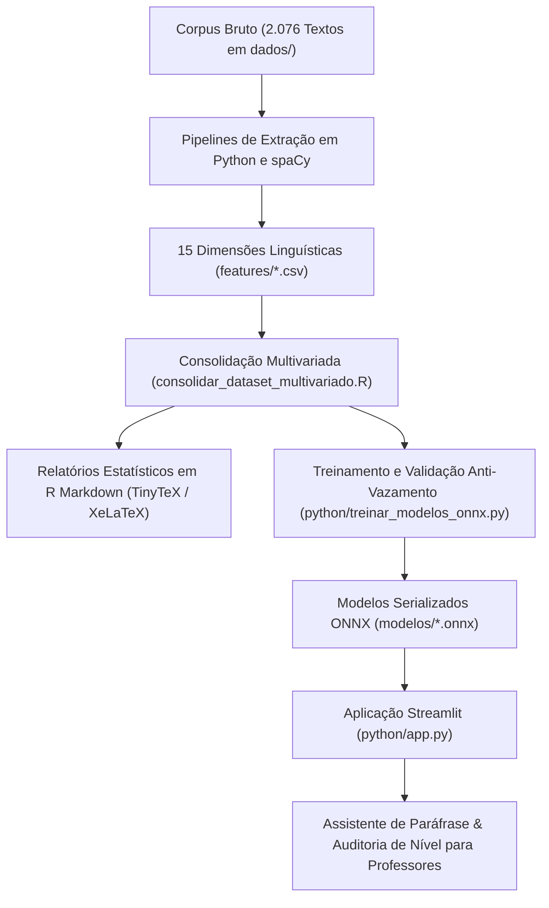

# ALFA-Gen: Avaliação Linguística e Filtragem Automática — Generator

> **ALFA-Gen** (**A**valiação **L**inguística e **F**iltragem **A**utomática — **Gen**erator) é um ecossistema integrado de Ciência de Dados, Linguística Computacional e Inteligência Artificial voltado à mensuração de complexidade textual, classificação de níveis de ensino em Língua Portuguesa e assistência pedagógica para elaboração de avaliações.
>
> 🌐 **Deploy Ativo (Streamlit Cloud):** [https://alfa-gen-mf7ewkugsz6zvada5trhqw.streamlit.app/](https://alfa-gen-mf7ewkugsz6zvada5trhqw.streamlit.app/)

O projeto compreende a extração de **15 dimensões morfossintáticas e lexicais** a partir de um corpus de **2.076 textos reais**, relatórios analíticos univariados e multivariados em **R Markdown / XeLaTeX**, treinamento de modelos preditivos com validação cruzada 5-fold estratificada (*no leakage*), exportação dos modelos em formato **ONNX** para inferência de alta performance e uma aplicação interativa em **Streamlit** com motor de paráfrase baseado em sinônimos mais frequentes e concordância nominal automática.

---

## Sumário

1. [Visão Geral da Arquitetura](#visão-geral-da-arquitetura)
2. [Ambiente R e Pacotes Estatísticos](#ambiente-r-e-pacotes-estatísticos)
3. [Ambiente Python e o Gerenciador `uv`](#ambiente-python-e-o-gerenciador-uv)
4. [Instalação e Configuração Passo a Passo](#instalação-e-configuração-passo-a-passo)
5. [Como Executar a Aplicação e os Scripts](#como-executar-a-aplicação-e-os-scripts)
6. [Mapeamento das 15 Features e Relatórios](#mapeamento-das-15-features-e-relatórios)
7. [Modelos Preditivos e Arquivos ONNX](#modelos-preditivos-e-arquivos-onnx)
8. [Estrutura do Repositório](#estrutura-do-repositório)

---

## Visão Geral da Arquitetura



---

## Ambiente R e Pacotes Estatísticos

O componente analítico e de geração de relatórios reproduzíveis do projeto utiliza a linguagem **R**.

### Versão do R
- **R Version:** `4.5.2` (2025-10-31 ucrt) — plataforma `x86_64-w64-mingw32`

### Pacotes R Requeridos

| Pacote | Versão Utilizada | Finalidade no Projeto |
|:---|:---:|:---|
| **`rmarkdown`** | `2.30` | Renderização dinâmica dos documentos `.Rmd` para relatórios em PDF. |
| **`knitr`** | `1.50` | Motor de chunks, processamento de código R e tabelas formatadas (`kable`). |
| **`tinytex`** | `0.57` | Distribuição LaTeX modular para compilação com a engine `xelatex`. |
| **`kableExtra`** | `1.4.0` | Estilização avançada de tabelas em LaTeX com linhas alternadas e formatação tipográfica. |
| **`dplyr`** | `1.1.4` | Manipulação, agrupamento e cálculo de métricas sumárias por nível de ensino. |
| **`lawstat`** | `3.6` | Testes de robustez estatística e homocedasticidade (Levene / Brown-Forsythe). |
| **`MASS`** | `7.3.65` | Suporte a métodos lineares e matrizes de covariância multivariadas. |
| **`moments`** | `0.14.1` | Cálculo exato de assimetria (*skewness*) e curtose (*kurtosis*) das distribuições. |
| **`nortest`** | `1.0.4` | Testes formais de normalidade (Anderson-Darling, Cramer-von Mises e Lilliefors). |

### Instalação dos Pacotes no R

No console do R ou RStudio:

```R
# 1. Instalar os pacotes analíticos do CRAN
pacotes <- c("rmarkdown", "knitr", "tinytex", "kableExtra", "dplyr", "lawstat", "MASS", "moments", "nortest")
install.packages(pacotes)

# 2. Instalar o TinyTeX para geração de PDFs (se ainda não instalado)
tinytex::install_tinytex()
```

### Como Compilar os Relatórios R Markdown

Para compilar qualquer relatório para PDF via terminal:

```powershell
# 1. Relatório de Análise Multivariada (15 dimensões)
Rscript -e "rmarkdown::render('relatorio_multivariado.Rmd')"

# 2. Relatório de Modelagem Preditiva e Benchmark de Classificação
Rscript -e "rmarkdown::render('relatorio_modelos.Rmd')"

# 3. Relatório de Trajetória Metodológica (1 página)
Rscript -e "rmarkdown::render('relatorio_trajetoria.Rmd')"

# Relatórios individuais de features (exemplo: Feature 01)
Rscript -e "rmarkdown::render('features/01_relatorio_features_canonicidade.Rmd', knit_root_dir = getwd())"
```

---

## Ambiente Python e o Gerenciador `uv`

Para a engenharia de atributos, processamento de linguagem natural (PLN), treinamento de modelos de *Machine Learning*, conversão ONNX e interface web, o projeto adota o **Python 3.14.6** gerenciado pelo **`uv`**.

### O que é o `uv`?

O [**`uv`**](https://github.com/astral-sh/uv) é um gerenciador de pacotes, dependências e ambientes virtuais para Python desenvolvido pela Astral (criadores do Ruff), escrito em Rust. Suas principais vantagens são:
- **Velocidade Extrema:** Resolução de dependências e instalação de pacotes de 10 a 100 vezes mais rápida que o `pip` tradicional.
- **Gerenciamento Unificado:** Substitui `pip`, `pip-tools`, `virtualenv` e gerenciadores de versão em uma ferramenta única e autocontida.
- **Resolução Determinística:** Garante ambientes perfeitamente reprodutíveis entre diferentes máquinas.

### Versões das Ferramentas
- **Python:** `3.14.6`
- **uv:** `0.12.1`

### Principais Bibliotecas Python

| Biblioteca | Versão | Função Principal |
|:---|:---:|:---|
| **`streamlit`** | `1.66.0` | Interface visual web interativa para professores. |
| **`spacy`** | `3.8.16` | Pipeline de PLN, análise sintática de dependência e POS tagging (`pt_core_news_sm`). |
| **`wordfreq`** | `3.1.1` | Medição de frequência lexical com base na escala logarítmica Zipf em português. |
| **`nltk`** | `3.10.3` | Tokenização sentencial (`punkt`) e consulta à base OpenWordNet-PT (`omw-1.4`/`omw-2.0`). |
| **`pyphen`** | `0.18.1` | Hifenização fonológica e separação silábica em português brasileiro (`pt_BR`). |
| **`scikit-learn`** | `1.9.1` | Pré-processamento, validação cruzada 5-fold, Random Forest e Regressão Logística. |
| **`lightgbm`** | `4.7.0` | Algoritmo campeão de Gradient Boosting com árvores de decisão. |
| **`onnxruntime`** | `1.31.0` | Mecanismo de inferência otimizado e multiplataforma para os modelos ONNX. |
| **`skl2onnx` / `onnxmltools`** | `1.20.0` / `1.16.0` | Conversores de modelos Scikit-Learn e LightGBM para o formato padronizado ONNX. |
| **`pandas` / `numpy`** | `3.0.6` / `2.5.3` | Estruturas de dados vetoriais e tabulares de alta performance. |

---

## Instalação e Configuração Passo a Passo

### 1. Clonar o Repositório

```bash
git clone https://github.com/seu-usuario/ALFA-Gen.git
cd ALFA-Gen
```

### 2. Instalar o `uv`

Caso ainda não possua o `uv` instalado em sua máquina:

- **Windows (PowerShell):**
  ```powershell
  powershell -ExecutionPolicy ByPass -c "irm https://astral.sh/uv/install.ps1 | iex"
  ```
- **Linux / macOS:**
  ```bash
  curl -LsSf https://astral.sh/uv/install.sh | sh
  ```

### 3. Criar e Ativar o Ambiente Virtual com `uv`

```powershell
# Criar o ambiente virtual isolado (.venv)
uv venv

# Ativar o ambiente virtual no Windows (PowerShell):
.venv\Scripts\activate

# (No Linux/macOS seria: source .venv/bin/activate)
```

### 4. Instalar as Dependências

Com o `uv`, a instalação de todas as dependências leva apenas alguns segundos:

```powershell
uv pip install -r requirements.txt
```

### 5. Baixar os Recursos Linguísticos (spaCy e NLTK)

Execute o comando a seguir para garantir o download do modelo spaCy e dos córpora NLTK:

```powershell
# Modelo em Língua Portuguesa do spaCy
python -m spacy download pt_core_news_sm

# Recursos do NLTK (WordNet OMW-PT e Tokenizadores)
python -c "import nltk; nltk.download('wordnet'); nltk.download('omw-1.4'); nltk.download('omw-2.0'); nltk.download('punkt'); nltk.download('punkt_tab')"
```

---

## Como Executar a Aplicação e os Scripts

### 1. Aplicação Online vs. Execução Local

- 🌐 **Acesso Direto em Nuvem (Deploy Ativo):**  
  👉 [https://alfa-gen-mf7ewkugsz6zvada5trhqw.streamlit.app/](https://alfa-gen-mf7ewkugsz6zvada5trhqw.streamlit.app/)

- 💻 **Execução Local (Streamlit):**
  ```powershell
  streamlit run python/app.py
  ```

Ou diretamente pelo `uv`:

```powershell
uv run streamlit run python/app.py
```

A interface abrirá automaticamente no navegador no endereço:
👉 **`http://localhost:8501`**

#### Funcionalidades da Aplicação:
- **Seleção de Textos do Acervo:** Permite navegar e sortear qualquer um dos 2.076 textos reais da base, exibindo o gabarito oficial.
- **Entrada de Texto Livre:** Permite ao professor digitar ou colar qualquer questão de prova.
- **Paráfrase com Sinônimos Comuns:** Substitui termos por seus equivalentes de maior frequência Zipf em português.
- **Concordância Nominal Automática:** Detecta a mudança de gênero do substantivo (ex: *a qualidade* $\rightarrow$ *o atributo*) e ajusta automaticamente artigos, demonstrativos e contrações preposicionais (*a* $\rightarrow$ *o*, *na* $\rightarrow$ *no*, *pela* $\rightarrow$ *pelo*, etc.).
- **Proteção Estrita de Fórmulas:** Garante que equações LaTeX (`$...$`), identificadores (`formula_1`), operações matemáticas e termos disciplinares (*matriz*, *linha*, *coluna*, *vértice*) permaneçam intocados.
- **Auditoria de Nível em Tempo Real:** Extrai as 15 *features* de ambos os textos e avalia via modelo ONNX se o nível pedagógico se manteve ou sofreu migração.

---

### 2. Executar o Treinamento e Exportação ONNX dos Modelos

Para re-treinar os modelos e re-exportar os arquivos ONNX com verificação de paridade numérica:

```powershell
python python/treinar_modelos_onnx.py
```

---

### 3. Executar o Pipeline de Extração das Features

Caso deseje reprocessar o corpus bruto a partir do arquivo compactado em `dados/`:

```powershell
# Extração dos 6 lotes de atributos linguísticos (diretório python/)
python python/extrair_canonicidade.py
python python/extrair_features_pontuacao_formula.py
python python/extrair_features_asl.py
python python/extrair_features_subordinativas.py
python python/extrair_novas_features.py
python python/extrair_features_lote3.py

# Consolidação do dataset multivariado completo (2.076 x 45)
Rscript consolidar_dataset_multivariado.R
```

---

## Mapeamento das 15 Features e Relatórios

Todos os 15 relatórios individuais estão rigorosamente organizados no diretório `features/`, numerados de **01 a 15**, espelhando a ordem do relatório de análise multivariada:

| Nº | Atributo Linguístico | Métrica Técnica | Relatório Fonte (Rmd) | Relatório PDF Compilado |
|:---:|:---|:---|:---|:---|
| **01** | Canonicidade Silábica | `prop_cv` | `features/01_relatorio_features_canonicidade.Rmd` | `features/01_relatorio_features_canonicidade.pdf` |
| **02** | Pontuação Expressiva | `pont_exp_prop` | `features/02_relatorio_features_pontuacao_expressiva.Rmd` | `features/02_relatorio_features_pontuacao_expressiva.pdf` |
| **03** | Fórmulas e Termos Técnicos | `formula_prop` | `features/03_relatorio_features_formula.Rmd` | `features/03_relatorio_features_formula.pdf` |
| **04** | Comprimento Médio da Sentença | `asl` | `features/04_relatorio_features_asl.Rmd` | `features/04_relatorio_features_asl.pdf` |
| **05** | Conjunções Subordinativas | `sconj_densidade` | `features/05_relatorio_features_subordinativas.Rmd` | `features/05_relatorio_features_subordinativas.pdf` |
| **06** | Razão Nominal (Subst / Verb) | `razao_nominal` | `features/06_relatorio_features_razao_nominal.Rmd` | `features/06_relatorio_features_razao_nominal.pdf` |
| **07** | Conjunções Coordenativas | `cconj_densidade` | `features/07_relatorio_features_coordenativas.Rmd` | `features/07_relatorio_features_coordenativas.pdf` |
| **08** | Proporção de Polissílabos | `prop_polissilabos` | `features/08_relatorio_features_polissilabos.Rmd` | `features/08_relatorio_features_polissilabos.pdf` |
| **09** | Vírgulas por Sentença | `virgulas_por_sentenca` | `features/09_relatorio_features_virgulas.Rmd` | `features/09_relatorio_features_virgulas.pdf` |
| **10** | Metadiscurso Acadêmico | `metadiscurso_prop` | `features/10_relatorio_features_metadiscurso.Rmd` | `features/10_relatorio_features_metadiscurso.pdf` |
| **11** | Citações Acadêmicas (ABNT) | `citacao_academica_prop` | `features/11_relatorio_features_citacao_academica.Rmd` | `features/11_relatorio_features_citacao_academica.pdf` |
| **12** | Sufixos e Nominalizações | `nominalizacao_prop` | `features/12_relatorio_features_nominalizacao.Rmd` | `features/12_relatorio_features_nominalizacao.pdf` |
| **13** | Conectivos Argumentativos | `conectivos_argumentativos_prop` | `features/13_relatorio_features_conectivos_argumentativos.Rmd` | `features/13_relatorio_features_conectivos_argumentativos.pdf` |
| **14** | Pontuação Estruturante | `pont_estruturante_prop` | `features/14_relatorio_features_pont_estruturante.Rmd` | `features/14_relatorio_features_pont_estruturante.pdf` |
| **15** | Densidade de Pessoalidade | `pessoalidade_prop` | `features/15_relatorio_features_pessoalidade.Rmd` | `features/15_relatorio_features_pessoalidade.pdf` |

### Relatórios Centrais de Síntese
- **Análise Multivariada (15 Dimensões):** [`relatorio_multivariado.Rmd`](relatorio_multivariado.Rmd) / [PDF](relatorio_multivariado.pdf)
- **Modelagem Preditiva & Benchmark:** [`relatorio_modelos.Rmd`](relatorio_modelos.Rmd) / [PDF](relatorio_modelos.pdf)
- **Trajetória Metodológica (1 página):** [`relatorio_trajetoria.Rmd`](relatorio_trajetoria.Rmd) / [PDF](relatorio_trajetoria.pdf)

---

## Modelos Preditivos e Arquivos ONNX

Os modelos foram treinados sobre 80% dos dados ($N = 1.660$) com validação cruzada 5-fold e avaliados no conjunto de teste independente ($N = 416$). Todos os artefatos foram serializados com **Opset 15** em `modelos/`:

| Modelo | Arquivo ONNX | Tamanho | Acurácia Teste | Balanced Acc | Macro F1 | ROC-AUC |
|:---|:---|:---:|:---:|:---:|:---:|:---:|
| **LightGBM** (Campeão) | `modelos/lightgbm.onnx` | 1.021 KB | **72,84%** | **72,40%** | **0,7161** | **0,9222** |
| **Random Forest** | `modelos/random_forest.onnx` | 2.719 KB | **72,12%** | **72,06%** | **0,7026** | **0,9155** |
| **Regressão Logística** | `modelos/regressao_logistica.onnx` | 1,1 KB | **70,19%** | **70,96%** | **0,6920** | **0,8952** |

---

## Estrutura do Repositório

```text
ALFA-Gen/
├── README.md                               # Documentação executiva completa do projeto
├── requirements.txt                        # Lista de dependências Python (uv pip freeze)
├── ALFA-Gen.Rproj                          # Projeto RStudio
├── relatorio_multivariado.Rmd (.pdf)       # Relatório central de análise multivariada (15 dimensões)
├── relatorio_modelos.Rmd (.pdf)            # Relatório central de modelagem preditiva e benchmark
├── relatorio_trajetoria.Rmd (.pdf)         # Relatório conciso da trajetória metodológica (1 página)
├── python/                                 # Scripts e módulos em Python
│   ├── app.py                              # Aplicação web Streamlit (Assistente do Professor)
│   ├── extrator_features.py                # Extrator unificado das 15 features em Python
│   ├── modificador_sinonimos.py            # Motor de paráfrase e concordância nominal
│   ├── classificador_onnx.py               # Mecanismo de inferência rápida via ONNX Runtime
│   ├── treinar_modelos_onnx.py             # Pipeline de treino, validação cruzada e exportação ONNX
│   └── extrair_*.py                        # Scripts de extração individual por lote
├── amostras_e_gabarito/                    # Experimento inicial de calibração humana
│   ├── 01_amostras_niveis_ensino.Rmd (.pdf)# Amostras dos 4 níveis e teste cego inicial
│   └── 02_gabarito_respostas.Rmd (.pdf)    # Gabarito oficial do teste cego
├── features/                               # Diretório dos 15 relatórios individuais
│   ├── 01_relatorio_features_canonicidade.Rmd (.pdf)
│   ├── 02_relatorio_features_pontuacao_expressiva.Rmd (.pdf)
│   ├── ...
│   └── 15_relatorio_features_pessoalidade.Rmd (.pdf)
├── modelos/                                # Artefatos serializados para produção
│   ├── lightgbm.onnx                       # Modelo campeão LightGBM (1.021 KB)
│   ├── random_forest.onnx                  # Modelo Random Forest (2.719 KB)
│   └── regressao_logistica.onnx            # Modelo de Regressão Logística (1,1 KB)
├── dados/                                  # Datasets consolidados e tabelas de métricas
│   ├── dataset_multivariado_features.csv   # Matriz multivariada (2.076 linhas x 45 colunas)
│   └── Prova de selecao.zip                # Corpus bruto contendo os 2.076 arquivos .txt
├── R/                                      # Módulos de funções estatísticas e gráficas
│   ├── funcoes_estatistica.R
│   ├── funcoes_graficos.R
│   └── funcoes_tabelas.R
├── consolidar_dataset_multivariado.R       # Script de consolidação das 15 features em R
└── preparar_dados.R                        # Script de amostragem inicial para o experimento
```

---

## Licença e Autoria

Projeto desenvolvido para fins educacionais, de pesquisa científica e avaliação automatizada em processamento de linguagem natural e legibilidade textual.
